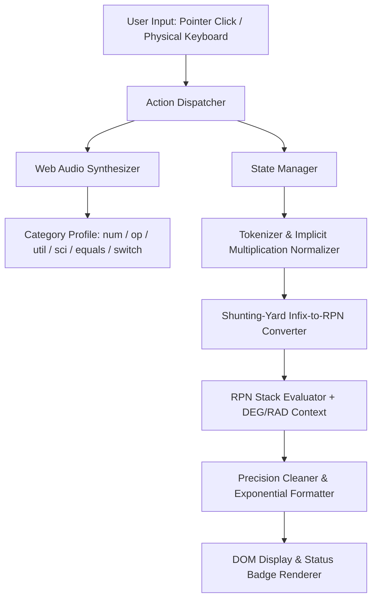

<div align="center">

# CALQ

### Tactile precision meets minimalist engineering.

A retro-modern, hardware-inspired calculator for the web—combining a deterministic Shunting-Yard mathematical engine, dual high-contrast themes, and real-time Web Audio mechanical acoustics in a zero-dependency frontend architecture.

<br />

[](#technology-stack)
[](#technology-stack)
[](#technology-stack)
[](#tactile-sound-architecture)
[](#deployment)

<br />

[**Explore Features**](#features) · [**Design Philosophy**](#design-philosophy) · [**Scientific Engine**](#scientific-calculator) · [**Keyboard Shortcuts**](#keyboard-shortcuts) · [**Quick Start**](#getting-started)

</div>

---

## Project Preview

<!-- Place your project screenshot at assets/preview.png inside the repository -->

<div align="center">
  
  <p><em>Calq rendered in Light and Dark hardware themes. Replace <code>assets/preview.png</code> with your repository screenshot.</em></p>
</div>

---

## Overview

**Calq** is a self-contained web calculator modeled afterindustrial handheld hardware. Rather than treating a calculator as a flat web form, Calq pairs a warm, physical surface language with a custom mathematical expression parser and procedural key switch acoustics.

Every calculation is tokenized and evaluated through a dedicated Reverse Polish Notation (RPN) pipeline without relying on `eval()` or `new Function()`. Every button interaction responds with layered sub-millisecond mechanical audio synthesized directly in the browser.

---

## Features

### Calculator Core
- **Deterministic Expression Engine** — Tokenizes infix expressions and evaluates them via Dijkstra's Shunting-Yard algorithm and a Reverse Polish Notation stack.
- **Floating-Point Precision Normalization** — Cleans IEEE-754 representation artifacts (such as $0.1 + 0.2 = 0.3$) using 12-significant-figure normalization and a $10^{-14}$ zero-snap threshold.
- **Live Expression Preview** — Continuously evaluates compound expressions as you type, displaying real-time intermediate results (`= ...`) or previous answer context (`Ans = ...`) in the secondary display register.
- **Context-Aware Percentage Handling** — Supports both relative commercial percentages ($A + B\% = A + A \times \frac{B}{100}$) and direct multiplicative percentages ($15\% \times 200 = 30$).
- **Implicit Multiplication** — Naturally resolves adjacent operands without requiring explicit multiplication operators, such as $2(3)$, $(2)(3)$, $2\pi$, and $2\sin(30)$.
- **Auto-Balanced Parentheses** — Automatically closes any unclosed opening parentheses upon evaluation.

### Scientific Operations
- **Expandable Dual-Pad Layout** — Seamlessly transitions from a compact $4 \times 5$ standard keypad into an expanded 40-key scientific workstation.
- **Trigonometric & Inverse Suite** — Full support for $\sin$, $\cos$, $\tan$, $\sin^{-1}$, $\cos^{-1}$, and $\tan^{-1}$ with instant `DEG` and `RAD` unit switching.
- **Logarithmic, Power & Factorial Functions** — Includes natural logarithms ($\ln$), base-$10$ logarithms ($\log_{10}$), arbitrary exponents ($x^y$), square/cube postfixes ($x^2$, $x^3$), square roots ($\sqrt{x}$), reciprocals ($1/x$), absolute values ($|x|$), and factorials ($x!$).
- **Explicit Domain Guardrails** — Surfaces clear, non-crashing diagnostic states for division by zero, negative square roots, non-positive logarithms, undefined tangents ($\tan 90^\circ$), inverse trig domain violations outside $[-1, 1]$, and factorial overflows ($n > 170$).

### Interface, Acoustics & Personalization
- **Inverted Dual Theme System** — Switches smoothly between a warm beige chassis with a recessed charcoal display (**Light**) and a matte charcoal chassis with a warm cream display (**Dark**).
- **Procedural Mechanical Key Acoustics** — Synthesizes real-time tactile key clicks using the browser's Web Audio API, featuring distinct acoustic profiles for numeric, operator, utility, scientific, equals, and toolbar switches.
- **Persistent User State** — Automatically remembers your selected theme, calculator mode, trigonometric angle unit, and audio mute preference across sessions via `localStorage`.
- **Responsive Multi-Tier Typography** — Dynamically scales the primary display across four font-size tiers based on digit count, formatting magnitudes $\ge 10^{12}$ or $< 10^{-9}$ in clean scientific notation.

---

## Design Philosophy

Calq is guided by **retro-modern industrial minimalism**—inspired by classic Braun and Dieter Rams-era pocket calculators where form, color hierarchy, and tactile feedback serve legibility.

| Design Pillar | Implementation in Calq |
| :--- | :--- |
| **Inverted Display Contrast** | In Light mode, a warm sand shell (`#E6DFCE`) frames a deep charcoal display (`#202020`). In Dark mode, the relationship inverts: a charcoal body (`#202020`) frames a warm parchment display (`#E5DFCE`). |
| **Semantic Color Coding** | Keys are grouped by cognitive role rather than decoration: muted coral red (`#ED554B`) for numeric input, slate blue (`#7191AC`) for arithmetic operators, and warm taupe (`#928476` / `#A59889`) for utility and scientific functions. |
| **Neomorphic Depth** | Multi-layered inset highlights and drop shadows create physical keycap elevation that depresses by `2px` on pointer click or keyboard actuation. |
| **Geometric Typography** | Pairs `Orbitron` and `Chakra Petch` for the display register and key legends—including a custom-rendered slashed zero—with `Inter` for peripheral controls. |
| **Adaptive Geometry** | On desktop viewports, scientific mode expands horizontally with a subtle vertical divider. On mobile viewports ($\le 639\text{px}$), the scientific pad stacks above the standard pad to prevent horizontal scrolling. |

---

## Architecture & Evaluation Pipeline

Calq processes every input through a strict, unidirectional pipeline from user interaction to DOM and audio output:



<details>
<summary><strong>Deep Dive: Tactile Sound Architecture (Web Audio API)</strong></summary>

<br />

Calq generates mechanical key clicks entirely in memory without loading external `.mp3` or `.wav` assets:

1. **Layer 1 — Keycap Body Resonance ("Thock"):** A triangle-wave `OscillatorNode` sweeps exponentially from a category-specific start frequency ($165\text{ Hz}$–$310\text{ Hz}$) down to $44\text{ Hz}$–$95\text{ Hz}$ over $22\text{ ms}$–$44\text{ ms}$.
2. **Layer 2 — Switch Contact Transient:** A pre-computed $40\text{ ms}$ white-noise buffer with an baked exponential decay ($t^{2.2}$) is routed through a `BiquadFilterNode` (`bandpass`, $Q = 2.4$) tuned between $1750\text{ Hz}$ and $3100\text{ Hz}$.
3. **Layer 3 — Equals Release Snap:** Pressing `=` triggers a secondary delayed sine transient ($340\text{ Hz} \to 110\text{ Hz}$) $14\text{ ms}$ after initial contact.
4. **Organic Micro-Jitter:** Each keystroke applies a $\pm 2.5\%$ random pitch multiplier so rapid typing never sounds robotic or repetitive.

</details>

---

## Scientific Calculator

Switching to **Scientific** mode unlocks 20 dedicated mathematical operations alongside the standard arithmetic pad.

| Category | Key | Operation / Expression | Implementation Notes |
| :--- | :---: | :--- | :--- |
| **Trigonometry** | `sin` | $\sin(x)$ | Respects active `DEG` or `RAD` mode |
| | `cos` | $\cos(x)$ | Respects active `DEG` or `RAD` mode |
| | `tan` | $\tan(x)$ | Guards against undefined asymptotes (e.g., $90^\circ$) |
| **Inverse Trig** | `sin⁻¹` | $\arcsin(x)$ | Domain $[-1, 1]$; returns `DEG` or `RAD` |
| | `cos⁻¹` | $\arccos(x)$ | Domain $[-1, 1]$; returns `DEG` or `RAD` |
| | `tan⁻¹` | $\arctan(x)$ | Real domain $(-\infty, \infty)$; returns `DEG` or `RAD` |
| **Logarithms** | `ln` | $\ln(x)$ | Natural logarithm ($\text{base } e$); requires $x > 0$ |
| | `log` | $\log_{10}(x)$ | Common logarithm ($\text{base } 10$); requires $x > 0$ |
| **Powers & Roots** | `√x` | $\sqrt{x}$ | Principal square root; requires $x \ge 0$ |
| | `x²` | $x^2$ | Postfix squaring operator |
| | `x³` | $x^3$ | Postfix cubing operator |
| | `xʸ` | $x^y$ | Right-associative binary exponentiation (`^`) |
| **Functions** | `\|x\|` | $\|x\|$ | Absolute magnitude (`abs(x)`) |
| | `1/x` | $1 \div x$ | Immediate reciprocal evaluation; guards $x \neq 0$ |
| | `x!` | $n!$ | Exact integer factorial for $0 \le n \le 170$ |
| **Constants** | `π` | $\pi \approx 3.14159265359$ | Evaluates using `Math.PI` |
| | `e` | $e \approx 2.71828182846$ | Evaluates using `Math.E` |
| **Grouping & Sci** | `( )` | Parenthetical grouping | Supports nested expressions & auto-closing |
| | `EXP` | $a \times 10^b$ (`aEb`) | Scientific notation entry |

---

## Keyboard Shortcuts

Calq supports full physical keyboard operation across both Standard and Scientific modes. Pressing a physical key triggers the matching on-screen button depression animation and tactile audio click.

| Keybinding | Action | Calculator Equivalent |
| :--- | :--- | :---: |
| `0` – `9` | Enter numeric digits | `0` – `9` |
| `.` or `,` | Insert decimal point | `.` |
| `+` | Addition operator | `+` |
| `-` | Subtraction or unary negation | `-` |
| `*` | Multiplication operator | `×` |
| `/` | Division operator | `÷` |
| `^` | Exponentiation ($x^y$) | `xʸ` |
| `%` | Percentage operator | `%` |
| `!` | Postfix factorial ($x!$) | `x!` |
| `(` and `)` | Open and close parentheses | `(` `)` |
| `p` or `P` | Insert Pi constant ($\pi$) | `π` |
| `Enter` or `=` | Evaluate current expression | `=` |
| `Backspace` | Delete last character or full function prefix | `⌫` |
| `Escape` or `Delete` | Clear all (`AC` / `C`) or dismiss modal | `AC` |
| `m` or `M` | Toggle tactile key click sound | `Click` / `Muted` |

---

## Technology Stack

Calq is intentionally built without frontend frameworks, bundlers, or external runtime packages.

| Technology | Role in Calq |
| :--- | :--- |
| **HTML5** | Semantic structure, `<output>` live regions, ARIA state attributes (`aria-pressed`, `aria-live="polite"`), and accessible button labels. |
| **CSS3** | Custom property theme engine (`[data-theme]`, `[data-mode]`), CSS Grid dual-keypad layout, tactile multi-layer shadows, and `prefers-reduced-motion` support. |
| **Vanilla JavaScript** | ES6+ IIFE architecture housing the state manager, custom tokenizer, Shunting-Yard RPN evaluator, keyboard controller, and `localStorage` persistence. |
| **Web Audio API** | Procedural sound synthesis using `AudioContext`, `OscillatorNode`, `BiquadFilterNode`, and `GainNode` for zero-latency tactile audio. |
| **Google Fonts** | `Orbitron` and `Chakra Petch` for geometric digital readouts, paired with `Inter` for UI controls. |

---

## Getting Started

Because Calq is a static, zero-build web application, you can run it directly in any modern browser.

### 1. Prerequisites
- Any modern web browser (Chrome, Edge, Firefox, Safari, Brave, or Arc).
- Optional: [Git](https://git-scm.com/) for cloning the repository.

### 2. Clone the Repository

```bash
git clone https://github.com/<your-username>/calq.git
cd calq
```

### 3. Open Locally

Open `index.html` directly in your browser:

```bash
# macOS
open index.html

# Linux
xdg-open index.html

# Windows
start index.html
```

### 4. Run with a Local Development Server (Optional)

If you prefer live reloading while inspecting or customizing the code, serve the directory with any static HTTP server:

```bash
# Using Python 3
python3 -m http.server 8080

# Or using Node.js npx serve
npx serve .
```

Then navigate to `http://localhost:8080` in your browser.

---

## Project Structure

Calq uses a self-contained single-file architecture so it can be deployed anywhere without a build step:

```text
calq/
├── index.html      # Complete application: semantic HTML5, CSS3 design system, and JS engine
└── README.md       # Project documentation
```

---

## Deployment

Calq is ready for immediate deployment on **GitHub Pages**, Vercel, Netlify, or any static web host.

### Deploying to GitHub Pages

1. Push your repository to GitHub.
2. Navigate to **Settings** $\rightarrow$ **Pages** in your GitHub repository.
3. Under **Build and deployment**, set **Source** to **Deploy from a branch**.
4. Select your default branch (e.g., `main`) and the `/ (root)` folder, then click **Save**.
5. GitHub Pages will publish your live instance at `https://<your-username>.github.io/calq/`.

---

## Browser Compatibility

Calq relies on standard, widely supported Web APIs:

| Feature / API | Browser Support | Notes |
| :--- | :--- | :--- |
| **CSS Grid & Custom Properties** | Chrome 57+, Firefox 52+, Safari 10.1+, Edge 16+ | Powers theme switching and responsive keypad layouts |
| **Web Audio API (`AudioContext`)** | Chrome, Firefox, Safari (`webkitAudioContext`), Edge | Synthesizes key clicks; gracefully no-ops if unavailable |
| **Web Storage (`localStorage`)** | All modern browsers | Wrapped in `try/catch` blocks to work safely in strict private browsing modes |

---

## Performance & Privacy

- **Zero Runtime Dependencies:** No third-party JavaScript bundles, analytics scripts, or tracking pixels are loaded.
- **100% Client-Side Execution:** All mathematical evaluations and audio synthesis run locally inside your browser tab.
- **Transparent Local Storage:** Calq stores only four lightweight preference keys in `localStorage`:
  - `mono_calc_theme_v1` (`'light'` | `'dark'`)
  - `mono_calc_mode_v1` (`'standard'` | `'scientific'`)
  - `mono_calc_angle_v1` (`'DEG'` | `'RAD'`)
  - `mono_calc_sound_v1` (`'on'` | `'off'`)
- **Graceful Motion Accessibility:** Respects system-level `@media (prefers-reduced-motion: reduce)` preferences by disabling non-essential transitions.

---

## Roadmap

### Completed
- [x] Reference-faithful **Light** and **Dark** hardware themes with inverted display contrast
- [x] **Standard** ($4 \times 5$) and **Scientific** ($8 \times 5$ desktop / stacked mobile) calculator modes
- [x] Custom Shunting-Yard & RPN mathematical evaluator (zero `eval()`)
- [x] IEEE-754 floating-point precision cleanup and automatic parenthesis balancing
- [x] Real-time Web Audio API tactile switch synthesizer with category-tuned acoustics
- [x] Full physical keyboard navigation and interactive shortcuts modal
- [x] Persistent user settings via `localStorage`

### Potential Future Enhancements
- [ ] Calculation history tape drawer with one-click expression recall
- [ ] Memory register keys (`MC`, `MR`, `M+`, `M-`)
- [ ] Copy-to-clipboard and paste support for the primary display register
- [ ] Optional PWA (`manifest.json` + Service Worker) for offline desktop and mobile installation

---

## Contributing

Contributions that refine calculation accuracy, accessibility, or visual polish are welcome.

1. **Fork** the repository.
2. **Create** a feature branch:
   ```bash
   git checkout -b feat/your-improvement
   ```
3. **Commit** your changes with clear, descriptive messages:
   ```bash
   git commit -m "feat: add calculation history drawer"
   ```
4. **Push** to your branch and open a **Pull Request**:
   ```bash
   git push origin feat/your-improvement
   ```

When contributing, please preserve the zero-dependency vanilla architecture and ensure all mathematical operations pass standard and scientific edge-case checks.

---

## License

A license has not yet been specified for this repository. All rights are reserved by the author unless a `LICENSE` file is added to the project root.

---

<div align="center">

**CALQ** — *Tactile precision meets minimalist engineering.*

[Back to Top](#calq)

</div>
